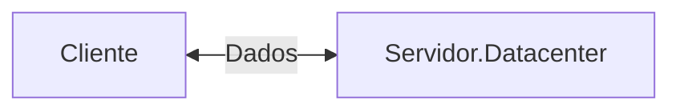
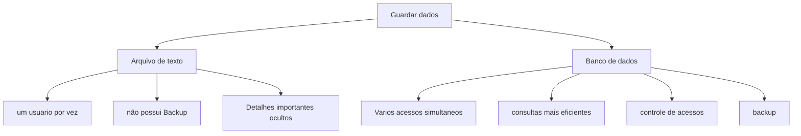
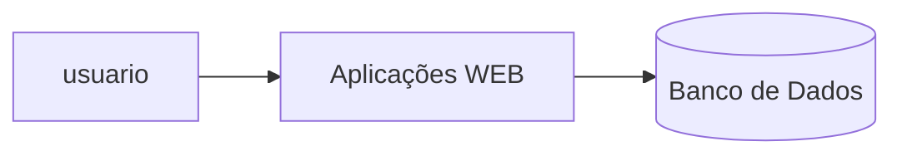

## servidor de Desenvolvimento
Será uma interface de desenvonvimento, utilizada para projetar aplicações e banco de dados.


---
## Servidor de Arquivos Educacional
É um servidor para armazenar arquivos e facilitar na hora de realizar a transferencia.

> O endereço para acesso ao servidor de arquivos é: `\\10.87.36.10`
>`Credenciais de acesso: E-mail: aluno, Senha: aluno IP:192.168.10.84`, Username:`root` e Porta:`2222`, Senha:`22102009@`

---
## Servidor Pessoal
O Moba será a interface para acesso ao meu servidor de desenvolvimento.
>O acesso, será realizado via SSH

Para alterar a senha, utilizamos o comando:
```bash
passwd
```

Para vizualizar os recursos do meu servidor foi utilizado o seguinte comando:
```bash
htop
```

---
|Recurso|Configuração
|----|-------|
|Processador|2 cores|
|RAM|512MB|
|Armazenamento|6 GB|
|Sistema Operacional|Ubuntu 26.04 LTS|
---
A utilização de um servidor de desenvolvimento, simula um ambiente real de produção são:

- Deploy de projetos
- Aplicação de bancos de dados
- Experiencia real de mercado


## Banco De Dados
Antigamente, os dados eram salvos em arquivos/planilhas.


Mas afinal onde entra um banco de dados em aplicações WEB 🤔?


## SGBD
Sistema Gerenciador de Banco de Dados

>Função: Gerenciar, controle e permitir consultas nos nossos bancos de dados.

```mermaid
graph TD
A[SGBD-PostgreSQL]-->B[(Banco de dados)]
A-->C[Armazena Usuarios]
A-->D[realizar consulta]
A-->E[controle de acesso]