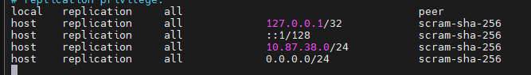

## Configurando o SGBD 
SGBD : Sistema Gerenciador de Banco de Dados
Para  Instalação, utilizamos o comando: 

```bash
sudo apt install -y postgresql
```

>No meu servidor, como eu já estava como root, não foi necessario o sudo.

Para acesso inicial, utilizamos o comando:

```bash
sudo -u postgres psql
```
>Autrnticação via linux, não necessita de senha, pois voce já está autenticado. (Socket local: O linux liberou o seu acesso).

Após primeiro acesso, alteramos a senha, através do comando:
```sql
ALTER USER postgres PASSWORD '---------';
```

Para sair do SGBD, utilizamos o comando: `\q`
>Comando famoso \quit em games

Para acesso externo, utilizamos o comando:
```bash
sudo psql -h 127.0.0.1 -U postgres
```
>Aqui, ele vai precisar da sneha pois ele não sabe quem voce é.

Alterações nos arquivos:
1. navegamos até o caminho:
```bash
cd /etc/postgresql/18/main
```
2. editamos o arquivo postgresql.conf atraves do comando
```bash
sudo nano postgresql.conf
```
linha listen_adresses = '*'
>Para pesquisar a linhas: `CTRL+W`

3. Segunda alteração no arquivo pg_hba.conf:
```bash
sudo nano pg_hba.conf
``` 
4. Alterações realizadas:


>Explicação do motivo do uso do 0.0.0.0
>é um IP neutro ou seja todos podem te aceso ao meu banco de dados tendo a minha senha, isso serve para que podemos usar o banco de dados em outros computadores fora da rede onde ele foi criado.

1. Comando SQL:
Usamos o comando CREATE DATABASE cidade;

`\l` = Lista de todos os bancos de dados

`sudo systemctle restart postgresql` = é a reportação e aplicação.

`sudo systectle status postgresql` = é a verificação do status da aplicação.

