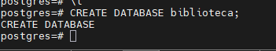
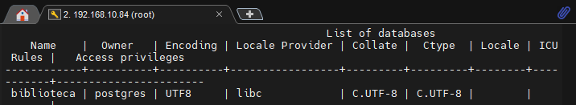
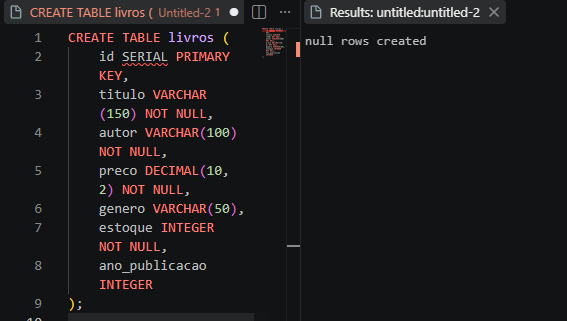
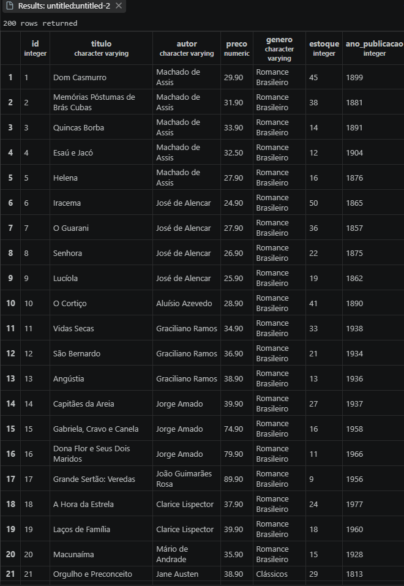
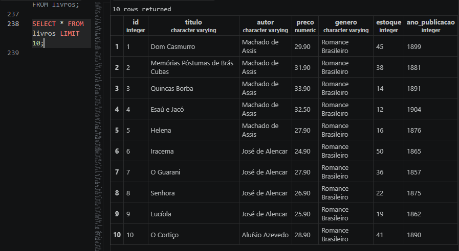

## Análise de Dados


 #### Criação da tabela

 ```SQL
CREATE TABLE produtos(
id SERIAL PRIMARY KEY,
nome VARCHAR (100) NOT NULL,
    categoria VARCHAR (50),
    preco DECIMAL (10,2) NOT NULL,
    estoque INTEGER NOT NULL
);
```
#### O que cada campo significa:
- id → identificador único do produto.
- nome → nome do produto.
- categoria → categoria à qual o produto pertence.
- preco → preço do produto.
- estoque → quantidade disponível em estoque.
- PRIMARY KEY → define o campo como chave primária.
- NOT NULL → significa que o campo não pode ficar vazio.
- SERIAL → gera automaticamente números para o id.

##### Dados da tabela

```SQL
INSERT INTO produtos (nome, categoria, preco, estoque) VALUES
('Mouse Óptico USB', 'Periféricos', 50.00, 120),
('Mouse Sem Fio', 'Periféricos', 89.90, 85),
('Mouse Gamer RGB', 'Periféricos', 249.00, 32),
('Teclado ABNT2 USB', 'Periféricos', 120.00, 64),
('Teclado Mecânico Gamer', 'Periféricos', 459.00, 18),
('Teclado Sem Fio Slim', 'Periféricos', 199.00, 40),
('Mousepad Grande', 'Periféricos', 45.00, 150),
('Suporte Ergonômico Notebook', 'Periféricos', 135.00, 28),
('Hub USB 4 Portas', 'Periféricos', 79.00, 95),
('Adaptador USB-C HDMI', 'Periféricos', 159.00, 47),

('Monitor 21,5 Full HD', 'Monitores', 750.00, 22),
('Monitor 24 Full HD IPS', 'Monitores', 950.00, 19),
('Monitor 27 QHD', 'Monitores', 1890.00, 8),
('Monitor 32 4K', 'Monitores', 2790.00, 4),
('Monitor Gamer 144Hz', 'Monitores', 1650.00, 11),
('Suporte Articulado Monitor', 'Monitores', 289.00, 26),

('Notebook Básico 8GB', 'Notebooks', 2890.00, 14),
('Notebook Intermediário 16GB', 'Notebooks', 4500.00, 9),
('Notebook Gamer RTX', 'Notebooks', 7990.00, 3),
('Notebook Ultrafino 14', 'Notebooks', 5300.00, 6),
('Chromebook 11', 'Notebooks', 1790.00, 17),
('Carregador Universal 65W', 'Notebooks', 189.00, 58),

('Impressora Laser Mono', 'Impressão', 800.00, 12),
('Impressora Multifuncional', 'Impressão', 1250.00, 7),
('Impressora Tanque de Tinta', 'Impressão', 1090.00, 10),
('Toner Compatível Preto', 'Impressão', 145.00, 72),
('Cartucho Colorido', 'Impressão', 98.00, 88),
('Papel A4 500 folhas', 'Impressão', 29.90, 240),
('Scanner de Mesa', 'Impressão', 690.00, 5),

('Roteador Wi-Fi 5 Dual Band', 'Redes', 249.00, 35),
('Roteador Wi-Fi 6 AX1500', 'Redes', 459.00, 16),
('Switch 8 Portas Gigabit', 'Redes', 329.00, 21),
('Cabo de Rede Cat6 5m', 'Redes', 35.00, 180),
('Repetidor de Sinal Wi-Fi', 'Redes', 139.00, 54),
('Placa de Rede USB Wi-Fi', 'Redes', 89.00, 66),
('Nobreak 1500VA', 'Redes', 980.00, 6),

('SSD 480GB SATA', 'Armazenamento', 289.00, 45),
('SSD 1TB NVMe', 'Armazenamento', 549.00, 24),
('SSD 2TB NVMe', 'Armazenamento',1090.00, 9),
('HD Externo 1TB', 'Armazenamento', 379.00, 31),
('HD Externo 2TB', 'Armazenamento', 549.00, 15),
('Pen Drive 64GB', 'Armazenamento', 49.90, 200),
('Pen Drive 128GB', 'Armazenamento', 79.90, 110),
('Cartão de Memória 128GB', 'Armazenamento', 99.00, 76),

('Headset Gamer com Microfone', 'Áudio', 250.00, 38),
('Headset Bluetooth', 'Áudio', 329.00, 27),
('Caixa de Som Bluetooth', 'Áudio', 189.00, 49),
('Fone Intra-Auricular', 'Áudio', 69.90, 130),
('Microfone Condensador USB', 'Áudio', 449.00, 13),
('Webcam Full HD 1080p', 'Áudio', 180.00, 41);
```


- Codigo para fazer filtros em colunas.
Isso é útil quando não precisamos visualizar todas as informações da tabela

```sql
SELECT nome,preco FROM produtos;
```

- Codigo para saber a quantidade de registros na tabela.
COUNT(*) conta a quantidade de registros.

```sql
SELECT COUNT(*) FROM produtos;
```

- Codigo para limitar dados na leitura da tabela.  LIMIT precisa receber a quantidade de registros que você quer visualizar.

```sql
SELECT * FROM produtos LIMIT;
```

- Codigo para categorizar os produtos da tabela em ordem alfabética. Para descobrir quais categorias existem ORDER BY organiza os resultados.

```sql
SELECT DISTINCT categoria FROM produtos ORDER BY categoria;
```


- Codigo de filtro para mostrar apenas uma cateoria. WHERE serve para criar uma condição/filtro.

```sql
SELECT nome,preco
FROM produtos
WHERE categoria='Áudio';
```

- Para mostrar produtos com preço entre 100 e 1000 O BETWEEN verifica se o valor está dentro de um intervalo.

```sql
SELECT nome,preco
FROM produtos
WHERE preco BETWEEN 100 AND 1000;
```

- 
```sql
SELECT nome,preco
FROM produtos
WHERE preco >= 100 AND preco <= 1000;
```

- 
```SQL
SELECT nome,preco 
FROM produtos
ORDER BY preco DESC;
```


## Atividade Aula 06

- Crie um novo banco de dados para armazenar a tabela de livros.






- Crie uma tabela com as colunas (id,nome,autor,preco,genero,estoque,ano_publicacao).





id → SERIAL: usei para o número do livro ser criado automaticamente.

titulo → VARCHAR(150): usei porque o título é um texto.

autor → VARCHAR(100): usei porque o nome do autor também é um texto.

preco → DECIMAL(10,2): usei porque é um valor de dinheiro e precisa ter duas casas depois da vírgula.

genero → VARCHAR(50): usei porque o gênero é um texto.

estoque → INTEGER: usei porque a quantidade de livros é um número inteiro.

ano_publicacao → INTEGER: usei porque o ano é um número inteiro.


- Depois disso adicionei o INSERT livros que estava no documento qu está na atividade.


### Bloco 1 — Reconhecimento da base

Objetivo: aprender a visualizar uma base de dados

 

#### 1. Exiba todos os dados da tabela, mas limitando o resultado aos 10 primeiros registros.



Ai está a imagem da tabela com todos os dados dos livros.
(obs: Não deu para aparecer todos os dados na foto).




Tabela mostrando apenas os 10 primeiros registros usando o comando `LIMIT`.