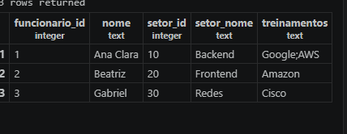
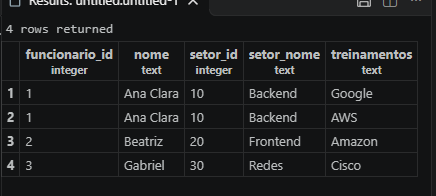
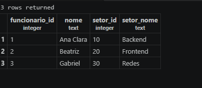
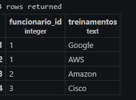
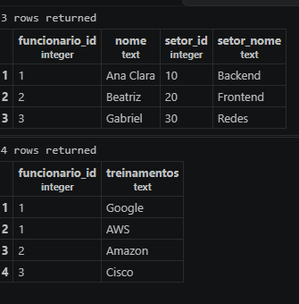

## Normalização de Banco de Dados

1. Primeiro criamos a tabela cadastro_original:

```sql
CREATE TABLE cadastro_original(
    funcionario_id INTEGER PRIMARY KEY,
    nome TEXT,
    setor_id INTEGER,
    setor_nome TEXT,
    treinamentos TEXT
);
```



2. Adicionamos os dados na tabela cadastro_original:

```sql
INSERT INTO cadastro_original VALUES
(1,'Ana Clara',10,'Backend','Google;AWS'),
(2,'Beatriz',20,'Frontend','Amazon'),
(3,'Gabriel',30,'Redes','Cisco');
```

3. criamos uma copia da primeira tabela, aplicando a 1fn:
Utilizamos a função string_to_table() para separar os treinamentos que estavam armazenados no mesmo campo.

```sql
CREATE TABLE cadastro_1fn AS
SELECT funcionario_id,nome,setor_id,setor_nome, string_to_table(treinamentos,';')
FROM cadastro_original;
```

4.Adicionamos a chave primária composta.
A chave primária composta é formada por duas colunas: funcionario_id e treinamentos. Assim, cada funcionário pode ter mais de um treinamento, sem repetir a mesma combinação.

```sql
ALTER TABLE cadastro_1fn
ADD PRIMARY KEY (funcionario_id,treinamentos);


```



### 2FN


1. separamos uma tabela para os funcionarios:
Selecionamos os dados dos funcionários, sem duplicações, utilizando SELECT DISTINCT.

```sql
CREATE TABLE funcionarios AS
SELECT DISTINCT funcionario_id,nome,setor_id,setor_nome
FROM cadastro_1fn;
```

2.Adicionamos a chave primária da tabela funcionarios
A coluna funcionario_id será a chave primária, identificando cada funcionário de forma única.


```sql
ALTER TABLE  funcionarios
ADD PRIMARY KEY (funcionario_id);
```



3. criamos uma tabela de participações
Essa tabela armazena o identificador de cada funcionário e os treinamentos dos quais ele participa.

```sql
CREATE TABLE participacoes AS
SELECT funcionario_id,treinamentos
FROM cadastro_1fn;



ALTER TABLE participacoes
ADD PRIMARY KEY (funcionario_id,treinamentos);
```

```sql
SELECT * FROM funcionarios;
SELECT * FROM participacoes;
```

